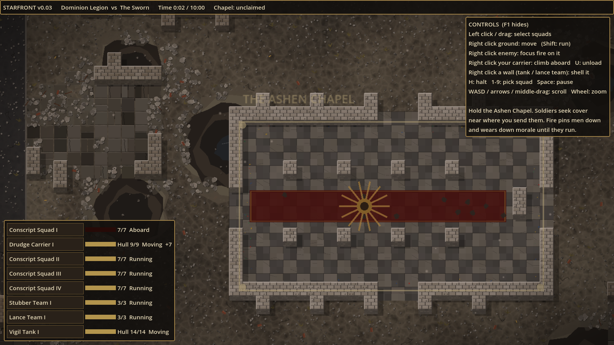

# StarFront

Real-time squad tactics in a ruined gothic future, in the spirit of the Close Combat games:
you give orders to squads, not individual men, and the battle turns on cover, line of sight,
suppression and morale. Soldiers who come under heavy fire get pinned down, and if they're
pushed too far they break and run.

Built with [Godot 4](https://godotengine.org/) (4.3 or newer). The art is placeholder for now,
drawn in code, so the game can be played and tuned before real sprites are made.

## Play it
1. Download Godot 4 (standard version, not .NET) from https://godotengine.org/download.
2. In the Project Manager choose **Import**, pick this folder's `project.godot`, then **Run** (F5).

## The prototype (v0.09)
- One procedurally generated ruined city map, different every battle, with the Ashen Chapel at its centre.
  Walls can be blown down.
- Two factions: the **Dominion Legion** (many brittle conscripts) and **The Sworn** (a few armoured warrior-monks),
  each with a troop carrier and a tank.
- Win by holding the chapel unchallenged for 3 minutes, by breaking the enemy, or by holding it when the 10 minutes run out.

### Controls
| Input | Action |
|---|---|
| Left click / drag | Select squads (Shift adds) |
| Right click ground | Move there (soldiers pick cover nearby). Shift + right click runs |
| Right drag | Line the squad up along the line, in cover, facing away from where they came |
| Ctrl + right click | Face that way (they prefer targets in that arc) |
| Alt + click a soldier | Pick out individual soldiers to order on their own |
| Right click a visible enemy | Concentrate fire on that soldier or vehicle |
| Right click your own carrier (infantry selected) | Climb aboard |
| U | Unload the selected carriers |
| Right click a wall (tank or Lance Team selected) | Shell the wall until it falls |
| H | Halt selected squads |
| 1-9 | Select a squad and jump to it |
| Space | Pause |
| WASD / arrows / middle-drag, mouse wheel | Scroll, zoom |
| F1 | Show or hide help |

## How the battle works
- **Line of sight:** walls and wrecks block it. You only see enemies your men can see, and an enemy
  lying still in cover is only spotted at close range until they fire.
- **Cover:** sandbags, barricades and crumbled low walls stop most fire from their far side but can be
  fired over; rubble, craters and ruin floors help less. Troops pick cover facing the threat and crouch
  behind it. Low cover wears away under fire.
- **Coherency:** a squad's men must stay within reach of each other, as in Epik.
- **Suppression:** every shot near a man adds suppression, which fades when the firing stops. Heavily
  suppressed soldiers go prone (pinned): they won't move and fire less.
- **Morale:** falls under fire and when squad-mates die, especially the leader. A soldier at very low
  morale routs and flees to his own map edge. A nearby leader helps the squad recover.
- **Vehicles:** armour is thickest at the front and thinnest at the rear. A weapon's penetration
  is compared with the armour of the side it hits, so rifles can't hurt a tank. Use anti-tank
  teams, and go for the flanks. Tank shells explode, hurting everyone near the blast.
- **Destructible walls:** explosions crack walls, knock stones out, and finally bring them down
  into rubble that can be crossed and seen through. Blast your own way in rather than using the doors.

## Project layout
- `scripts/game_data.gd`: factions, soldier types and weapons (the balance numbers).
- `scripts/battle_map.gd`: map generation, terrain, path-finding, line of sight, cover and wall damage.
- `scripts/map_view.gd`, `scripts/map_painter.gd`: draw the map in detailed tiles, repainting them as walls fall.
- `scripts/height_painter.gd`, `scripts/normal_from_height.gdshader`: the normal maps that give the map relief under lights.
- `scripts/light_fx.gd`: lights from muzzle flashes, bolts, rockets and explosions.
- `scripts/soldier.gd`, `scripts/squad.gd`: soldiers, squads, morale and orders.
- `scripts/vehicle.gd`: carriers and tanks (driving, turrets, armour, passengers).
- `scripts/ai_commander.gd`: the computer opponent.
- `scripts/main.gd`: battle setup, the main loop, shooting, input and camera.
- `scripts/hud.gd`, `scripts/overlay.gd`, `scripts/effects.gd`: interface and effects.
- `docs/STYLE_GUIDE.md`: the setting and the art direction.
- `tools/autotest.sh`: plays computer-vs-computer battles without a window, for testing and balance.
